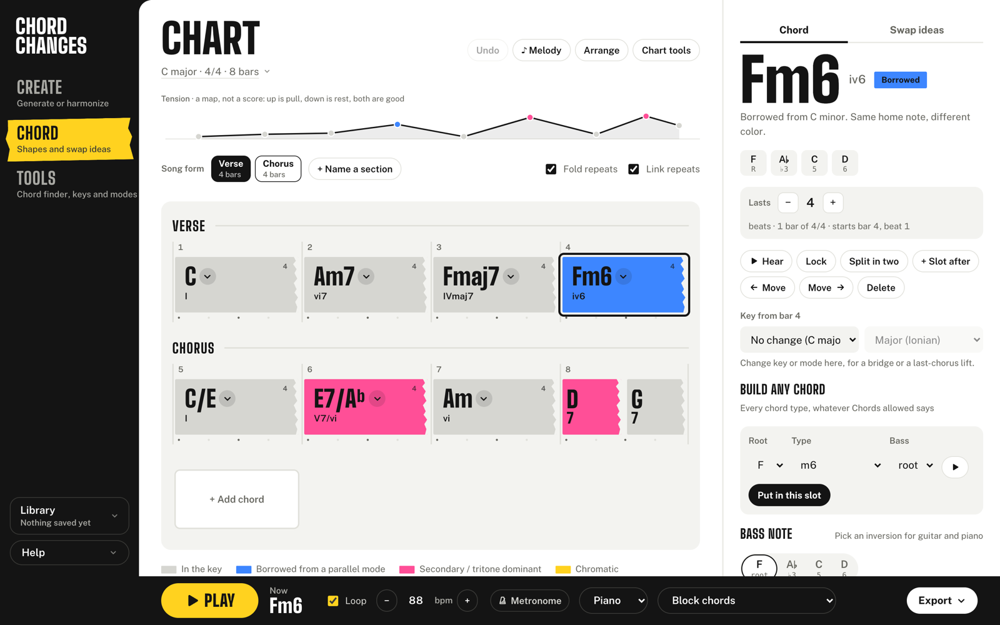

# Chord Changes

[](https://github.com/ssk0011/chord-progression-generator/actions/workflows/test.yml)

A songwriting workbench for chord progressions. Bring your own chords or a melody, or start from a mood. Hear them, see why each chord works, try alternatives and arrangements, and take the result into your music app. You don't need to know music theory to start; the theory is there when you want it.

**Open it:** https://ssk0011.github.io/chord-progression-generator/



## What it does

- **Explains why.** Every chord is coloured by its job (in the key, borrowed, secondary dominant, chromatic), and every swap idea says in plain words why it works.
- **Plays and shows it.** Guitar shapes for any tuning and capo, piano voicings, and playing styles from block chords to Broadway stride and jazz ballad piano.
- **Works with a melody.** A melody lane colours each note against its chord, suggests chords for a typed tune, and arranges it for string quartet, choir, barbershop, close harmony or orchestra, with explanations.
- **Gets out of your way.** MIDI and MusicXML export, share links, a printable lead sheet, and live MIDI out to your DAW.
- **Private.** One HTML file, no account, no server, no tracking. Your work stays in your browser unless you export or share it.

The built-in sound is for hearing the harmony, not for production. The talam, taal and drone tools are sketching aids.

## Help pages

- [How to use it](https://ssk0011.github.io/chord-progression-generator/guide.html)
- [How it works under the hood](https://ssk0011.github.io/chord-progression-generator/how-it-works.html)

## Working on it

The app is `index.html`, with no build step. Open it in a browser, or serve the folder:

```bash
python3 -m http.server 8000
```

**Help pages.** `guide.html` and `how-it-works.html` are built from `docs-src/`. After editing a `*.body.html` file there, rebuild them:

```bash
python3 docs-src/build.py . docs-src
```

**Tests.** The tests are a Playwright smoke suite that drives the real page in Chromium, plus WebKit for the iPhone checks:

```bash
cd tests && npm ci && npx playwright install chromium webkit && npm test
```

CI runs the same suite on every push and pull request, except the iPhone audio checks, which need WebKit on macOS and run only on a Mac. It also fails if the committed help pages don't match a fresh build.

**Renaming.** The app's name is the `APP_NAME` constant at the top of the script in `index.html`. The page title, header, exports, messages and help pages all follow it. A test checks that the plain-HTML fallbacks (`<title>`, the header) match the constant, so change those in the same edit. Saved-data keys (`changes-v1`, …) deliberately stay put, so a rename doesn't lose anyone's work.

## Licence

No licence has been chosen yet. Until one is added, all rights are reserved.
